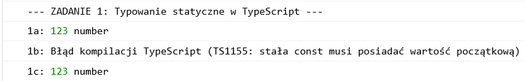
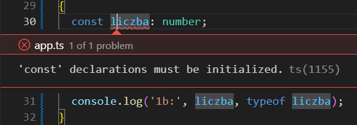
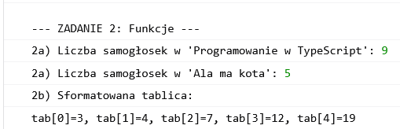
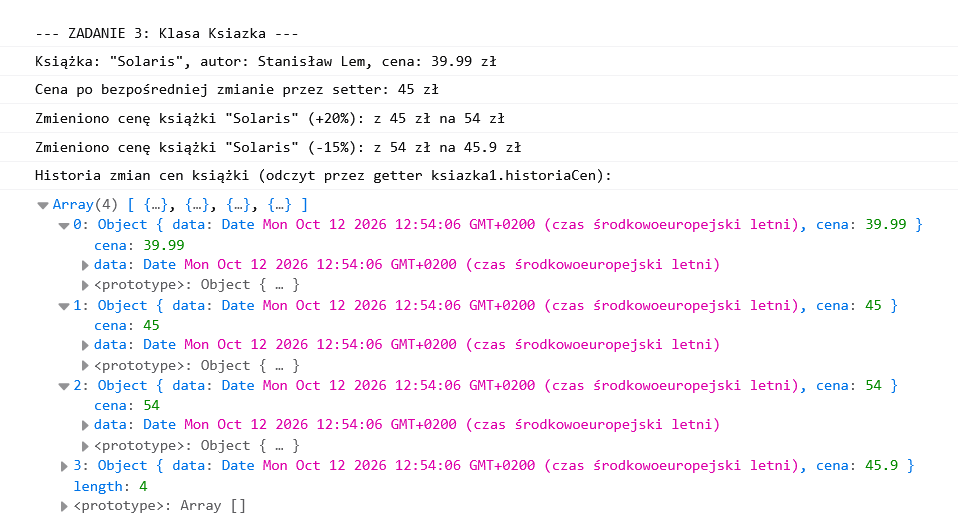

# Zadanie 2 – TypeScript: Typowanie statyczne, funkcje i programowanie obiektowe

Sprawozdanie z realizacji zadań w środowisku Angular / TypeScript.

Kod źródłowy znajduje się w pliku: [src/app/app.ts](src/app/app.ts).

---

## 1. Typowanie statyczne w TypeScript

W ramach zadania przeanalizowano trzy przypadki deklaracji zmiennych:

```typescript
// a) Jawne typowanie statyczne z inicjalizacją
const liczba: number = 123;
console.log('1a:', liczba, typeof liczba);

// b) Stała bez inicjalizacji (powoduje błąd kompilacji)
// const liczba: number;
// console.log('1b:', liczba, typeof liczba);

// c) Wnioskowanie typów (Type Inference)
const liczba = 123;
console.log('1c:', liczba, typeof liczba);
```

_(Źródło: [src/app/app.ts#L20-L41](src/app/app.ts#L20-L41))_

### Wyniki i zrzuty ekranu:

- **Wynik w konsoli po uruchomieniu (przypadki a oraz c+komunikat do b):**  
  

- **Błąd kompilatora po odkomentowaniu podpunktu b:**  
  

### Dlaczego to tak działa?

W TypeScript stała zadeklarowana słowem kluczowym `const` musi być bezwzględnie zainicjalizowana wartością w miejscu deklaracji, dlatego przypadek **(b)** skutkuje błędem kompilatora `TS1155: 'const' declarations must be initialized` i uniemożliwia uruchomienie kodu. W przypadkach **(a)** i **(c)** kod wykonuje się poprawnie i wyświetla `123 "number"` – wariancie (a) typ `: number` podano jawnie, natomiast w wariancie (c) kompilator sam go wydedukował.

---

## 2. Funkcje

### a) Zliczanie samogłosek w tekście

Funkcja przechodzi po znakach tekstu (zamienionego na małe litery) i zlicza wystąpienia polskich oraz angielskich samogłosek:

```typescript
function zliczSamogloski(tekst: string): number {
  const samogloski = 'aąeęioóuy';
  let licznik = 0;
  for (const znak of tekst.toLowerCase()) {
    if (samogloski.includes(znak)) {
      licznik++;
    }
  }
  return licznik;
}
```

_(Źródło: [src/app/app.ts#L52-L62](src/app/app.ts#L52-L62))_

### b) Formatowanie tablicy liczb

Funkcja mapuje tablicę liczb do wymaganego formatu `"tab[index]=wartość"` i łączy elementy przecinkami:

```typescript
function wypiszTablice(tab: number[]): void {
  const sformatowanyTekst = tab.map((wartosc, index) => `tab[${index}]=${wartosc}`).join(', ');
  console.log(sformatowanyTekst);
}
```

_(Źródło: [src/app/app.ts#L67-L71](src/app/app.ts#L67-L71))_

### Wyniki w konsoli:

```typescript
console.log(
  "2a) Liczba samogłosek w 'Programowanie w TypeScript':",
  zliczSamogloski('Programowanie w TypeScript'),
);
console.log("2a) Liczba samogłosek w 'Ala ma kota':", zliczSamogloski('Ala ma kota'));
wypiszTablice([3, 4, 7, 12, 19]);
```



---

## 3. Klasa `Ksiazka` (Programowanie Obiektowe)

Klasa modeluje książkę z zachowaniem pełnej hermetyzacji, kontroli dostępu przez gettery/settery oraz rejestracją historii zmian cen.

### a) Hermetyzacja

Pola stanu są prywatne (`private`), co uniemożliwia ich bezpośrednią modyfikację z zewnątrz i chroni integralność obiektu:

```typescript
private _autor: string = '';
private _tytul: string = '';
private _cena: number = 0;
private _historiaCen: { data: Date; cena: number }[] = []; // Tablica przechowująca historię zmian cen książki
```

_(Źródło: [src/app/app.ts#L88-L91](src/app/app.ts#L88-L91))_

### b) Konstruktor

Konstruktor przekazuje parametry bezpośrednio do setterów, co pozwala od razu zwalidować dane wejściowe oraz automatycznie utworzyć pierwszy wpis w historii cen:

```typescript
constructor(autor: string, tytul: string, cena: number) {
  this.autor = autor;
  this.tytul = tytul;
  this.cena = cena;
}
```

_(Źródło: [src/app/app.ts#L94-L98](src/app/app.ts#L94-L98))_

### c) Gettery i Settery

Umożliwiają odczyt i modyfikację właściwości w naturalny sposób (`obiekt.właściwość`), jednocześnie walidując dane (np. blokując pusty tekst lub cenę `<= 0`):

```typescript
get autor(): string { return this._autor; }
set autor(nowyAutor: string) {
  if (nowyAutor.trim().length === 0) return console.error('Błąd: Autor nie może być pusty!');
  this._autor = nowyAutor;
}

get tytul(): string { return this._tytul; }
set tytul(nowyTytul: string) {
  if (nowyTytul.trim().length === 0) return console.error('Błąd: Tytuł nie może być pusty!');
  this._tytul = nowyTytul;
}

get cena(): number { return this._cena; }
set cena(nowaCena: number) {
  if (nowaCena <= 0) return console.error('Błąd: Cena musi być większa od 0!');
  this._cena = Math.round(nowaCena * 100) / 100;
  this._historiaCen.push({ data: new Date(), cena: this._cena });
}
```

_(Źródło: [src/app/app.ts#L103-L140](src/app/app.ts#L103-L140))_

### d) Metody

#### 1. `zmienCene(oIleProcent)`

Oblicza nową wartość i ustawia ją za pomocą settera `this.cena = nowaCena`, dzięki czemu nie powiela logiki walidacji, zaokrąglania ani dodawania wpisu do historii:

```typescript
zmienCene(oIleProcent: number): void {
  const staraCena = this.cena;
  const nowaCena = this.cena * (1 + oIleProcent / 100);

  this.cena = nowaCena;

  if (this.cena !== staraCena) {
    console.log(
      `Zmieniono cenę książki "${this._tytul}" (${oIleProcent > 0 ? '+' : ''}${oIleProcent}%): z ${staraCena} zł na ${this.cena} zł`
    );
  }
}
```

_(Źródło: [src/app/app.ts#L149-L161](src/app/app.ts#L149-L161))_

#### 2. `historiaCen`

Getter tylko do odczytu (_read-only property_, brak settera), który zwraca płytką kopię tablicy `[...this._historiaCen]`, uniemożliwiając jej zresetowanie lub manipulację z zewnątrz:

```typescript
get historiaCen(): { data: Date; cena: number }[] {
  return [...this._historiaCen];
}
```

_(Źródło: [src/app/app.ts#L143-L145](src/app/app.ts#L143-L145))_

---

### Testy i wyniki w konsoli:

```typescript
const ksiazka1 = new Ksiazka('Stanisław Lem', 'Solaris', 39.99);

console.log(`Książka: "${ksiazka1.tytul}", autor: ${ksiazka1.autor}, cena: ${ksiazka1.cena} zł`);

ksiazka1.cena = 45.0;
console.log(`Cena po bezpośredniej zmianie przez setter: ${ksiazka1.cena} zł`);

ksiazka1.zmienCene(20);
ksiazka1.zmienCene(-15);

console.log('Historia zmian cen książki (odczyt przez getter ksiazka1.historiaCen):');
console.log(ksiazka1.historiaCen);
```

_(Źródło: [src/app/app.ts#L164-L176](src/app/app.ts#L164-L176))_


